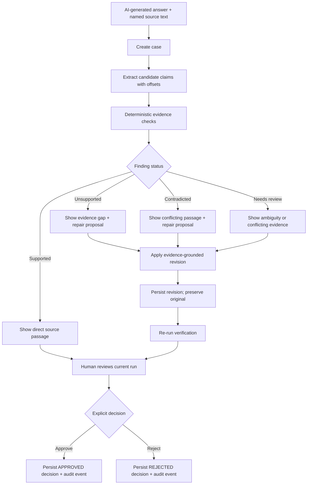
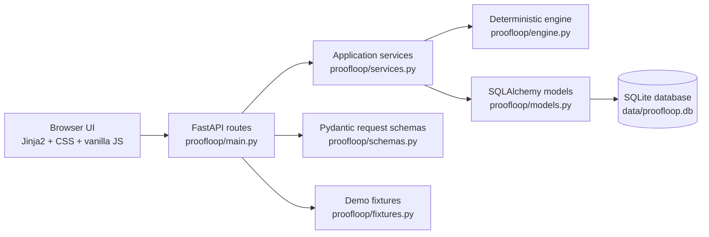

# ProofLoop AI

**Make AI decisions inspectable. Verify every claim. Trace every piece of evidence. Keep humans in control.**

[](.python-version)
[](requirements.lock)
[](proofloop/db.py)
[](LICENSE)

ProofLoop AI is a local-first, evidence-first reliability workbench for AI-generated decisions. Give it an AI answer and named source documents. It extracts candidate claims, checks them with conservative deterministic rules, shows the exact evidence or evidence gap, proposes a repair, re-runs verification, and records an explicit human approval or rejection.

It is intentionally **not** a truth oracle, calibrated probability model, or autonomous approval system. A `supported` result means that the implemented local rule found a direct textual match in the supplied sources; it does not mean that the world has been proven true.

## At a glance

- **Offline core:** no model credentials, network calls, vector database, or paid API is required.
- **Claim-level provenance:** source IDs, source names, excerpts, and character offsets are retained.
- **Fail-closed statuses:** `supported`, `unsupported`, `contradicted`, and `needs_review`.
- **Repair loop:** remove, qualify, or rewrite a claim in a separate revision, then verify again.
- **Human gate:** approval and rejection are explicit persisted decisions.
- **Audit trail:** verification runs, revisions, decisions, and event history can be exported as JSON.
- **Small dependable stack:** FastAPI, Jinja2, vanilla JavaScript, SQLAlchemy, and SQLite.

> Current scope: pasted text sources and sentence-like claim extraction. PDF ingestion, web browsing, authentication, and general semantic entailment are not implemented.

## Navigation

- [Why ProofLoop AI](#why-proofloop-ai)
- [Core capabilities](#core-capabilities)
- [How ProofLoop works](#how-proofloop-works)
- [Architecture](#architecture)
- [Technology stack](#technology-stack)
- [Repository structure](#repository-structure)
- [Quick start](#quick-start)
- [Configuration](#configuration)
- [Using the demo](#using-the-demo)
- [API reference](#api-reference)
- [Practical API walkthrough](#practical-api-walkthrough)
- [Verification behavior](#verification-behavior)
- [Data model and persistence](#data-model-and-persistence)
- [Testing and quality](#testing-and-quality)
- [Security and limitations](#security-and-limitations)
- [Roadmap](#roadmap)
- [Contributing](#contributing)
- [License and acknowledgments](#license-and-acknowledgments)

## Why ProofLoop AI

An AI answer can sound plausible while mixing supported facts, missing evidence, and direct contradictions. Ordinary chat interfaces make those differences difficult to inspect: the answer is visible, but the claim boundaries, source passages, matching rule, and reviewer decision are often not.

ProofLoop AI is designed for situations where a person needs to answer questions such as:

- Which exact claim is unsupported?
- Which source passage caused a contradiction finding?
- Was the answer changed after verification?
- Did a human approve the current revision, or only an earlier draft?
- Can another reviewer reconstruct what the system checked?

Example: an AI-generated launch brief says that a product requires an external model provider. A source document says the core engine runs offline. ProofLoop exposes the conflicting claim, preserves the source excerpt and offsets, proposes a repair path, blocks approval of a stale pre-repair verification run, and records the final human decision.

## Core capabilities

| Capability | Status | What is actually implemented |
| --- | --- | --- |
| Case creation | Implemented | Create a case with an answer and 1–50 named text sources. |
| Candidate claim extraction | Implemented | Deterministic sentence-like extraction with character offsets. Numbered list markers are excluded. |
| Claim editing | Implemented | Edit an existing persisted claim through the API and UI control. |
| Evidence matching | Implemented | Normalized token matching, explicit polarity checks, hedge detection, overlap review, and provenance. |
| Supported / unsupported / contradicted / needs review | Implemented | Statuses are generated by the local engine, not selected by demo labels. |
| Multiple source documents | Implemented | Sources are stored per case with names and SHA-256 content hashes. |
| Evidence explorer | Implemented | Case UI renders claim results, source names, excerpts, relations, and offsets. |
| Repair proposals | Implemented | The engine proposes next steps for non-supported findings. |
| Repair application | Implemented | `REMOVE`, `REWRITE`, and `QUALIFY` can create a separate revision; incomplete/no-op repairs are rejected. |
| Re-verification | Implemented | A fresh verification run stores a new input snapshot and metrics. |
| Revision preservation | Implemented | The original answer remains unchanged; revisions are persisted separately. |
| Human approval/rejection | Implemented | Decisions are persisted and approval of stale claims/answers is blocked. |
| Audit trail and export | Implemented | Audit events and a JSON case export are available. |
| Dashboard aggregates | Implemented | Counts are computed from persisted cases and latest verification runs. |
| Case history search/filter | Implemented in UI | Client-side search and status filters over the rendered case list. |
| Rich rewrite editor | Partial | API supports replacement text; the current UI emphasizes removal/manual-review actions. |
| Semantic entailment | Not implemented | The engine does not use an LLM or general-purpose semantic model. |
| Authentication/authorization | Not implemented | The application is a local/single-instance MVP. |

## How ProofLoop works

1. **Submit an answer and sources.** The API validates a case title, answer, and named source text documents.
2. **Extract candidate claims.** The engine splits answer text into sentence-like units and preserves `[start, end)` offsets.
3. **Evaluate each claim.** Each claim is compared to every source segment using deterministic normalized token and polarity rules.
4. **Inspect evidence.** Results include source IDs, source excerpts, source offsets, relation, rule explanation, and rationale.
5. **Identify repair or review work.** Unsupported, contradicted, hedged, and conflicting findings receive a repair proposal or review recommendation.
6. **Apply a repair.** A selected repair changes the current answer and creates a separate revision. The original answer is preserved.
7. **Re-run verification.** The new answer and claim set receive a fresh persisted verification run. A stale run cannot be used for a decision.
8. **Record the human decision.** An explicit `APPROVED` or `REJECTED` decision is persisted with a comment, run reference, timestamp, and audit event.



### Stage inputs, outputs, and persistence

| Stage | Receives | Produces | Persisted records |
| --- | --- | --- | --- |
| Case creation | Title, answer, source names/content | Case ID and source IDs | `cases`, `sources`, `audit_events` |
| Claim extraction | Current answer | Candidate claim text and offsets | `claims`, `audit_events` |
| Verification | Active claims and source text | Finding status, evidence, rationale, metrics | `verification_runs`, `audit_events` |
| Repair | Claim ID and repair action | New current answer | `revisions`, updated `cases`, `claims`, `audit_events` |
| Decision | Current case and fresh run | Approval or rejection | `human_decisions`, `audit_events` |
| Export | Case ID | JSON audit representation | Read-only response |

## Architecture

ProofLoop AI is a modular monolith. The browser receives server-rendered Jinja2 pages and progressively enhances them with one vanilla JavaScript bundle. FastAPI routes call service functions, the service layer invokes the pure verification engine, and SQLAlchemy persists the case lifecycle in SQLite.



### Component responsibilities

- **Application shell:** `templates/base.html`, `templates/dashboard.html`, and `templates/case.html` provide navigation, case creation, evidence inspection, repair controls, decision controls, and audit display.
- **Client behavior:** `static/app.js` calls the existing API, renders persisted results, handles loading/error states, filters claims/cases, and coordinates source selection.
- **Presentation system:** `static/app.css` defines the dark slate/violet visual system and responsive layouts.
- **HTTP layer:** `proofloop/main.py` exposes HTML pages and JSON routes.
- **Validation:** `proofloop/schemas.py` validates case, source, claim, repair, and decision inputs, including non-blank fields and repair replacement requirements.
- **Verification engine:** `proofloop/engine.py` is pure Python. It has no network or provider dependency and can be tested without SQLite.
- **Persistence:** `proofloop/db.py` creates the configured SQLAlchemy engine, ensures SQLite directories exist, enables SQLite foreign keys, and initializes tables with `create_all`.
- **Domain records:** `proofloop/models.py` stores cases, sources, claims, revisions, verification runs, human decisions, and audit events.
- **Aggregates:** `dashboard_stats()` derives dashboard counts from persisted cases and their latest verification-run metrics.

### Important design decisions

- A verification run stores an input snapshot, engine version, result JSON, and metrics JSON so a reviewer can inspect what was checked.
- The original answer is not overwritten by a repair.
- A human decision is rejected if the latest run does not match the current answer and active claims.
- SQLite keeps the project easy to run locally, but it is not a multi-instance production database.
- Audit events are persisted application records; they are not cryptographically chained or tamper-proof.

## Technology stack

| Layer | Technology | Role |
| --- | --- | --- |
| Runtime | Python 3.12 | Pinned by `.python-version` |
| Web framework | FastAPI 0.115.6 | HTTP API, HTML routes, OpenAPI generation |
| Server | Uvicorn 0.34.0 | Development and container process |
| Templates | Jinja2 3.1.5 | Server-rendered HTML |
| Browser layer | Vanilla JavaScript and CSS | Progressive enhancement; no frontend build step |
| Validation | Pydantic 2.14.1 / pydantic-settings | Request models and environment configuration |
| Persistence | SQLAlchemy 2.0.36 + SQLite | Relational case and audit state |
| Tests | Pytest 8.3.4 + FastAPI TestClient | Offline unit and API tests |
| Packaging | Docker + pinned requirements | Reproducible container execution |

## Repository structure

```text
proofloop ai/
├── proofloop/
│   ├── __init__.py       # Package version
│   ├── config.py         # Environment-backed settings
│   ├── db.py             # SQLAlchemy engine/session setup
│   ├── engine.py         # Pure deterministic verifier
│   ├── fixtures.py       # Three offline demo scenarios
│   ├── main.py           # FastAPI app, HTML routes, API routes
│   ├── models.py         # SQLite/SQLAlchemy domain models
│   ├── schemas.py        # Pydantic request validation
│   └── services.py       # Persistence, verification, serialization, aggregates
├── templates/
│   ├── base.html         # Application shell
│   ├── dashboard.html    # Overview, case creation, history
│   └── case.html         # Evidence explorer, repairs, decisions, audit
├── static/
│   ├── app.css           # Responsive design system
│   └── app.js            # Browser API integration and interactions
├── tests/
│   ├── test_engine.py    # Pure verification tests
│   └── test_api.py       # API, persistence, workflow tests
├── data/.gitkeep         # Default writable SQLite directory
├── Dockerfile
├── .env.example
├── .python-version
├── requirements.txt      # Docker install input
├── requirements.lock     # Fully pinned development/test install
├── LICENSE
└── README.md
```

## Quick start

### Prerequisites

- Python 3.12. The repository pins `3.12.8` in `.python-version`.
- A writable checkout directory.
- Docker is optional and only needed for container execution.

### Windows

The repository path may contain spaces. Quote it when changing directories:

```powershell
cd "C:\Users\rishi\OneDrive\Desktop\proofloop ai"
py -3.12 -m venv .venv
.venv\Scripts\python -m pip install -r requirements.lock
.venv\Scripts\python -m uvicorn proofloop.main:app --reload --host 127.0.0.1 --port 8000
```

Open <http://127.0.0.1:8000>.

If `8000` is already in use, choose another port:

```powershell
.venv\Scripts\python -m uvicorn proofloop.main:app --reload --host 127.0.0.1 --port 8001
```

### macOS and Linux

```bash
cd "/path/to/proofloop ai"
python3.12 -m venv .venv
.venv/bin/python -m pip install -r requirements.lock
.venv/bin/python -m uvicorn proofloop.main:app --reload --host 127.0.0.1 --port 8000
```

The application does not require an external service for its core workflow.

## Configuration

Copy the safe example file before changing settings:

```powershell
copy .env.example .env
```

Available variables:

| Variable | Default | Used for |
| --- | --- | --- |
| `APP_NAME` | `ProofLoop AI` | Application settings metadata |
| `ENVIRONMENT` | `development` | Environment label |
| `DATABASE_URL` | `sqlite:///./data/proofloop.db` | SQLAlchemy database URL |
| `HOST` | `0.0.0.0` | Documented runtime setting; local Uvicorn commands set host explicitly |
| `PORT` | `8000` | Docker start command port fallback and platform port injection |
| `LOG_LEVEL` | `info` | Configuration value reserved for runtime logging |

For local development, the documented Uvicorn command is the source of truth for host and port. The default SQLite directory is created automatically by the database layer.

## Using the demo

Start the app, then choose one of the scenario cards on the overview page:

| Scenario | Expected result | What it demonstrates |
| --- | --- | --- |
| Supported: offline verification | `supported` | Direct source-backed matches |
| Unsupported: enterprise synchronization | `unsupported` | No adequate evidence; absence is not contradiction |
| Contradicted: external model required | `contradicted` | Explicit source conflict |

The scenarios create real persisted cases through the same service path used by the API. They are deterministic fixtures for demonstrating behavior, not a benchmark of general-purpose factual accuracy.

## API reference

The running application exposes:

- Interactive Swagger UI: <http://127.0.0.1:8000/docs>
- Machine-readable OpenAPI: <http://127.0.0.1:8000/openapi.json>

The examples below use `http://127.0.0.1:8000` as `BASE_URL`.

### `GET /health`

Read-only process health endpoint.

```json
{
  "status": "ok",
  "service": "proofloop-ai",
  "version": "0.1.0"
}
```

Returns `200` when the application process is responding. It is not a full dependency readiness check.

### `GET /api/cases`

Lists persisted cases and returns dashboard aggregates.

```json
{
  "cases": [],
  "stats": {
    "total_cases": 0,
    "verified_cases": 0,
    "claims_checked": 0,
    "unsupported_or_contradicted": 0,
    "cases_awaiting_review": 0
  }
}
```

Read-only. Returns `200`.

### `POST /api/cases`

Creates a case, persists its sources, extracts candidate claims, and records creation/extraction events.

Request:

```json
{
  "title": "Launch brief review",
  "answer": "The platform uses SQLite. External providers are mandatory for verification.",
  "sources": [
    {"name": "Architecture brief", "content": "The platform uses SQLite."},
    {"name": "Engine note", "content": "External providers are not mandatory for verification."}
  ]
}
```

Validation rules:

- `title`: required, non-blank, maximum 200 characters.
- `answer`: required, non-blank, maximum 100,000 characters.
- `sources`: 1–50 entries.
- Each source name is required and each source content is non-blank, maximum 100,000 characters.

Returns `201` with the serialized case, including IDs, claims, sources, and any latest run. Returns `422` for invalid input.

### `GET /api/cases/{case_id}`

Returns one serialized case, including:

- Original and current answer
- Sources and SHA-256 content hashes
- Claims and offsets
- Latest verification run, metrics, findings, and engine version
- Revisions
- Human decisions
- Audit history

Read-only. Returns `200` or `404`.

### `POST /api/cases/{case_id}/claims/extract`

Replaces the active claim set by extracting sentence-like claims from the current answer.

Modifies persisted claims and records an audit event. Returns `200` with the serialized case or `404` for an unknown case.

### `PATCH /api/claims/{claim_id}`

Edits one persisted claim.

Request:

```json
{"text": "The platform uses SQLite."}
```

The edited claim is saved and an audit event is recorded. The next verification must reflect the edited state; approval of an older run is rejected. Returns `200`, `404`, or `422`.

### `POST /api/cases/{case_id}/verify`

Runs the deterministic engine against active claims and all source documents.

It persists:

- Verification run ID
- Engine version
- Full input snapshot
- Claim findings and evidence JSON
- Metrics JSON
- Completion audit event

Returns `200` or `404`.

### `POST /api/cases/{case_id}/repairs/apply`

Applies one or more selected repair actions and creates a separate revision.

Request:

```json
[
  {"claim_id": "claim-id", "action": "REMOVE"},
  {"claim_id": "another-claim-id", "action": "REWRITE", "replacement_text": "The source does not establish this capability."}
]
```

Allowed actions:

- `REMOVE`
- `QUALIFY` with `replacement_text`
- `REWRITE` with `replacement_text`
- `MANUAL_REVIEW` is accepted by the schema but does not change the answer and therefore returns `409` when applied alone.

The original answer is preserved. A no-op repair returns `409`; invalid payloads return `422`; unknown cases return `404`.

### `POST /api/cases/{case_id}/decision`

Records an explicit human decision for the latest verification state.

Request:

```json
{
  "decision": "APPROVED",
  "comment": "Reviewed the current evidence and revision."
}
```

`decision` must be `APPROVED` or `REJECTED`. The endpoint returns `409` if no verification run exists or if the latest run does not match the current answer and active claims. Returns `200`, `404`, `409`, or `422`.

### `GET /api/cases/{case_id}/audit`

Returns the case's chronological audit events in reverse chronological order. Read-only. Returns `200` or `404`.

### `GET /api/cases/{case_id}/export`

Returns the serialized case as a downloadable JSON response with a case-specific filename. Read-only. Returns `200` or `404`.

### `GET /api/demo/{scenario}`

Creates and verifies one deterministic fixture. Valid values are `supported`, `unsupported`, and `contradicted`.

Returns `200` with a newly created `case_id`, or `404` for an unknown scenario. This endpoint modifies persisted data and should be treated as a demo/seed action.

## Practical API walkthrough

The following walkthrough uses illustrative values and the verified API contract. IDs are generated by the application and must be captured from each response.

### 1. Create a mixed-evidence case

```bash
curl -X POST http://127.0.0.1:8000/api/cases \
  -H "Content-Type: application/json" \
  -d '{
    "title": "Launch brief review",
    "answer": "The platform uses SQLite. External providers are mandatory for verification. The launch is successful.",
    "sources": [
      {"name": "Architecture brief", "content": "The platform uses SQLite."},
      {"name": "Engine note", "content": "External providers are not mandatory for verification."}
    ]
  }'
```

The response contains the generated case ID and extracted claim IDs. The three claims are intentionally different:

- The SQLite claim has direct support.
- The external-provider claim is contradicted.
- The launch claim has no evidence and is unsupported.

### 2. Run verification

```bash
curl -X POST http://127.0.0.1:8000/api/cases/{case_id}/verify
```

Inspect `latest_run.results.results`. Each result contains a claim, status, rationale, evidence list, and any repair proposals. Evidence items include source IDs, source offsets, relation, score, and reason.

### 3. Apply a repair

For the contradicted claim, use its actual claim ID from the create or verify response:

```bash
curl -X POST http://127.0.0.1:8000/api/cases/{case_id}/repairs/apply \
  -H "Content-Type: application/json" \
  -d '[{"claim_id":"{contradicted_claim_id}","action":"REMOVE"}]'
```

The response contains a new revision and a changed `current_answer`. `original_answer` remains unchanged.

### 4. Re-verify the revision

```bash
curl -X POST http://127.0.0.1:8000/api/cases/{case_id}/verify
```

Approval of the pre-repair run is intentionally rejected. A fresh run is required.

### 5. Record a human decision

```bash
curl -X POST http://127.0.0.1:8000/api/cases/{case_id}/decision \
  -H "Content-Type: application/json" \
  -d '{"decision":"APPROVED","comment":"Reviewed source-linked findings and current revision."}'
```

### 6. Inspect audit history

```bash
curl http://127.0.0.1:8000/api/cases/{case_id}/audit
curl -OJ http://127.0.0.1:8000/api/cases/{case_id}/export
```

## Verification behavior

The engine is deliberately conservative and deterministic.

### Status definitions

| Status | Meaning in this implementation |
| --- | --- |
| `supported` | A direct normalized textual match was found without a detected conflicting polarity or hedge. |
| `contradicted` | A source contains a matching proposition with opposite explicit polarity. |
| `unsupported` | No source contains a sufficiently direct or materially overlapping statement. |
| `needs_review` | Evidence is hedged, partially overlapping, directly matched alongside ambiguous polarity, or conflicting across sources. |

### Matching rules

The engine currently:

- Normalizes Unicode, case, punctuation, and whitespace for comparison.
- Splits claims and source documents into sentence-like segments.
- Preserves original character offsets for extracted claims and evidence passages.
- Accepts direct contiguous token matches as the strongest textual evidence.
- Detects explicit polarity markers such as `not`, `never`, `cannot`, and related forms.
- Detects uncertainty markers such as `may`, `might`, `maybe`, `perhaps`, `possibly`, `probably`, `estimated`, and `no evidence`.
- Uses a conservative content-word overlap threshold to route partial matches to review rather than support.
- Routes supporting and contradicting evidence from different sources to `needs_review`.

### Metrics

For a completed run:

- `total_claims = supported + contradicted + unsupported + needs_review`
- `claims_with_evidence` counts claims with at least one evidence item.
- `evidence_coverage = claims_with_evidence / total_claims`
- `support_rate = supported / total_claims`
- `contradiction_rate = contradicted / total_claims`
- `review_rate = needs_review / total_claims`

These are verification-process metrics. They are not calibrated truth probabilities.

### Known verification limitations

- The engine does not perform general semantic entailment.
- Synonyms and antonyms are not comprehensively modeled.
- Clause-level negation and hedge scope can remain ambiguous.
- Compound claims may be routed to `needs_review` even when part of the claim is supported.
- Dates, quantities, units, temporal validity, and entity aliases are not specialized rule types.
- A source passage can be relevant by token overlap without establishing the complete claim; this is why partial overlap is review-only.

## Data model and persistence

The default database is `data/proofloop.db`. Tables are created at application startup with SQLAlchemy `Base.metadata.create_all()`; there is no migration framework in this MVP.

| Model | Purpose |
| --- | --- |
| `Case` | Original answer, current answer, status, decision status, timestamps |
| `Source` | Named source content and SHA-256 hash for a case |
| `Claim` | Active claim text, position, and answer offsets |
| `Revision` | Separate repaired answer and revision reason |
| `VerificationRun` | Engine version, input snapshot, result JSON, metrics JSON, timestamp |
| `HumanDecision` | Approval/rejection, comment, run reference, timestamp |
| `AuditEvent` | Append-style application event payload and timestamp |

SQLite foreign keys are enabled. The database directory is created automatically for SQLite URLs. The schema is suitable for local and single-instance use, not horizontal multi-instance deployment.

### Persistence caveats

- The default SQLite file is local state and should be backed up if cases matter.
- Container deployments need a persistent volume mounted at `/app/data`.
- Ephemeral hosting filesystems can lose the database on restart.
- Audit events are not cryptographically tamper-evident.
- Source text is persisted and included in serialized case responses; do not treat the MVP as a hardened sensitive-data vault.

## Testing and quality

Run the supported test command from the project virtual environment:

```powershell
.venv\Scripts\python -m pytest -q
git diff --check
```

The current repository run completed with:

```text
19 passed, 63 warnings
```

The tests cover:

- Direct support and source provenance
- Unsupported claims and missing evidence
- Explicit contradictions
- Conflicting source passages
- Hedged and ambiguous evidence
- Evidence offsets and source IDs
- Transparent metric calculations
- Empty and malformed engine inputs
- Numbered-list claim extraction
- Invalid claim offsets
- Non-blank API validation
- Demo scenario differentiation
- Case creation and persistence
- Human decision persistence
- Audit export
- Repair revision creation
- Rejection of stale approval after a repair
- Rejection of no-op and incomplete repairs

The suite runs offline and uses temporary SQLite databases for API tests. It does not provide browser-console coverage, visual regression snapshots, concurrency/load testing, authentication tests, or semantic accuracy benchmarking.

### Warnings and environment note

The suite currently emits deprecation warnings from the FastAPI/Starlette test stack, including the existing `@app.on_event("startup")` usage. These warnings do not fail the test run.

Use the project virtual environment. A global Python installation without the locked dependencies will fail during API test collection with errors such as `ModuleNotFoundError: No module named 'sqlalchemy'`.

## Security and limitations

### Current safeguards

- No API keys or provider credentials are required by the core engine.
- Inputs are validated through Pydantic models.
- Whitespace-only titles, answers, sources, and claims are rejected.
- Source content hashes are recorded.
- Verification input snapshots are persisted.
- Approval of stale answer/claim state is rejected.
- Secrets are not part of the sample fixtures or default database model.

### Not implemented

- Authentication and authorization
- User or team isolation
- Encrypted source storage
- Fine-grained source access control
- Rate limiting and upload quotas
- Cryptographically tamper-proof audit logs
- Database migrations and production backup automation
- PDF/OCR/file ingestion
- External model provider integration
- Browser end-to-end test automation

Use the project for local evaluation, demos, and controlled evidence review. Human judgment remains necessary, especially for `needs_review`, compound claims, conflicting sources, and any decision with material consequences.

## Docker and deployment

Build and run the existing container:

```bash
docker build -t proofloop-ai .
docker run --rm -p 8000:8000 -v proofloop-data:/app/data proofloop-ai
```

The Dockerfile:

- Uses Python `3.12.8`.
- Installs the pinned application requirements from `requirements.txt`.
- Copies the application, templates, static assets, fixtures directory, README, license, and environment example.
- Runs Uvicorn on `0.0.0.0`.
- Uses `${PORT:-8000}` for the container port.
- Runs as a non-root `appuser`.

For a platform such as Render or Railway, configure the platform-provided `PORT`, expose `/health` as the health check, and attach persistent storage for `/app/data`. No live deployment is included in this repository.

## Troubleshooting

### `ModuleNotFoundError: No module named 'sqlalchemy'`

The global Python interpreter is being used. Install and run through the project virtual environment:

```powershell
.venv\Scripts\python -m pip install -r requirements.lock
.venv\Scripts\python -m pytest -q
```

### Port 8000 is already in use

Use another port:

```powershell
.venv\Scripts\python -m uvicorn proofloop.main:app --reload --host 127.0.0.1 --port 8001
```

### Data is not persisting in Docker

Mount `/app/data` to a named volume or host directory. Without a persistent mount, the SQLite file is inside the disposable container filesystem.

### A decision returns `409`

Run verification after the latest claim edit or repair. ProofLoop intentionally refuses to approve a stale run.

### A repair returns `409`

The selected action did not change the current answer. Choose a real removal, qualification, or rewrite with replacement text.

## Roadmap

### Completed

- Deterministic offline claim verification
- Four explicit finding statuses
- Source excerpts, names, and character offsets
- Multiple named text sources
- Repair revisions and re-verification
- Human approval/rejection gate
- Persisted verification runs and audit export
- Dashboard aggregates and case history UI
- Responsive server-rendered interface
- Offline unit/API test suite

### In progress

- Richer claim-level repair editing in the browser
- More precise source highlighting and clause-level explanations
- Removal of remaining framework deprecation warnings

### Planned

- More structured rule types for numeric, date, unit, and temporal claims
- Better semantic evaluation datasets and adversarial regression corpus
- Cryptographically chained audit records
- Authentication, authorization, and tenant isolation
- Safer source-document access boundaries
- File/PDF/OCR ingestion
- Browser end-to-end and visual regression tests
- PostgreSQL deployment option for multi-instance workloads

## Contributing

Contributions are welcome, especially in the areas that improve evidence transparency without weakening conservative behavior.

### Development setup

```powershell
cd "C:\Users\rishi\OneDrive\Desktop\proofloop ai"
py -3.12 -m venv .venv
.venv\Scripts\python -m pip install -r requirements.lock
```

### Before opening a pull request

```powershell
.venv\Scripts\python -m pytest -q
git diff --check
```

Please:

- Keep the core verifier offline and deterministic unless a change explicitly adds a documented optional boundary.
- Add regression tests for new matching rules and failure modes.
- Preserve source provenance and original-answer immutability.
- Do not turn heuristic scores into truth probabilities.
- Do not add secrets, personal source data, generated databases, or host-specific paths.
- Update this README when routes, schemas, deployment behavior, or limitations change.

Useful contribution areas:

- Adversarial verification fixtures
- Better clause-scoped negation and hedge handling
- Structured numeric/date/unit rules
- Revision and repair UX
- SQLite migration strategy
- Browser automation and accessibility testing
- Security hardening and source access controls

For bug reports, include the smallest reproducible claim/source pair, expected status, actual status, engine version, and the test command used. For feature requests, describe the evidence and auditability requirement before proposing UI details.

## License and acknowledgments

ProofLoop AI is released under the [MIT License](LICENSE).

The project is built with open-source Python packages listed in [requirements.lock](requirements.lock), including FastAPI, Uvicorn, Jinja2, Pydantic, SQLAlchemy, Pytest, and HTTPX. Their respective licenses remain with their projects and distributions.

The repository currently contains no separate contributor roster, hosted demo, or public support address. Please use the repository's issue and pull-request mechanisms when this project is published to GitHub.
